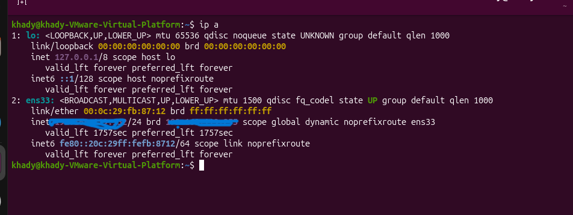
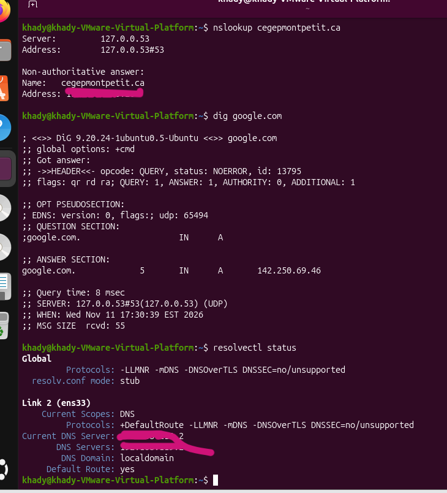
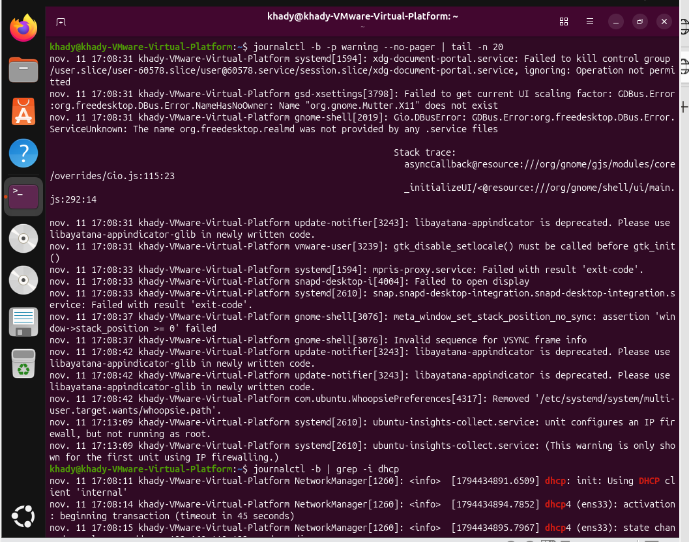
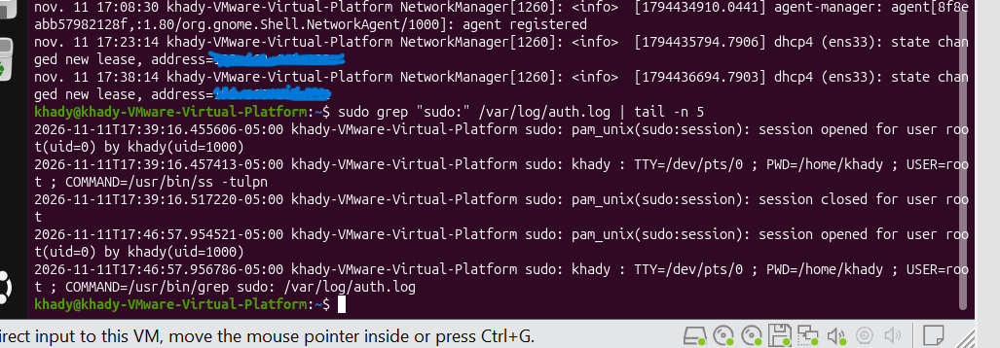
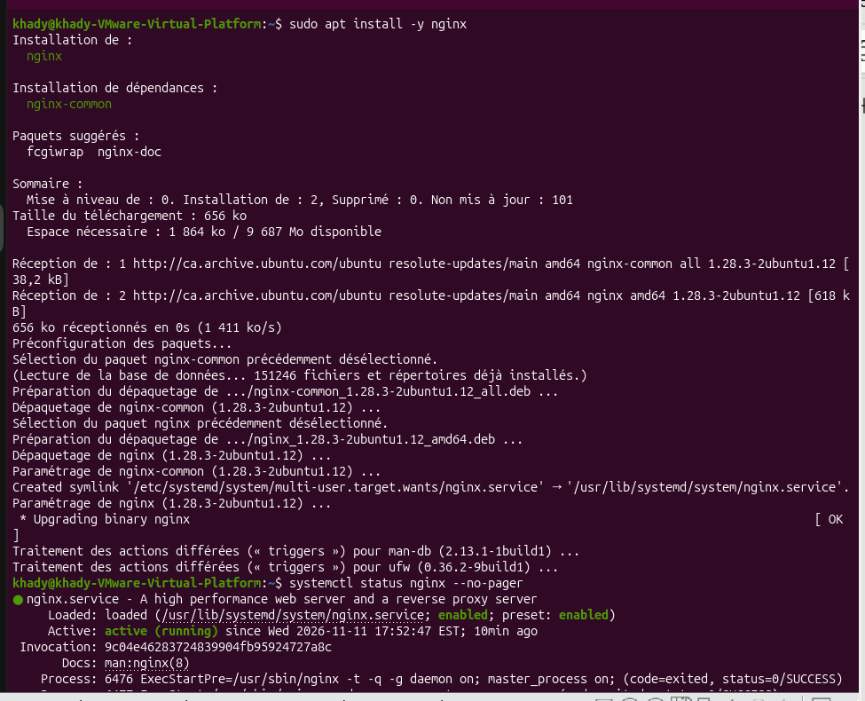
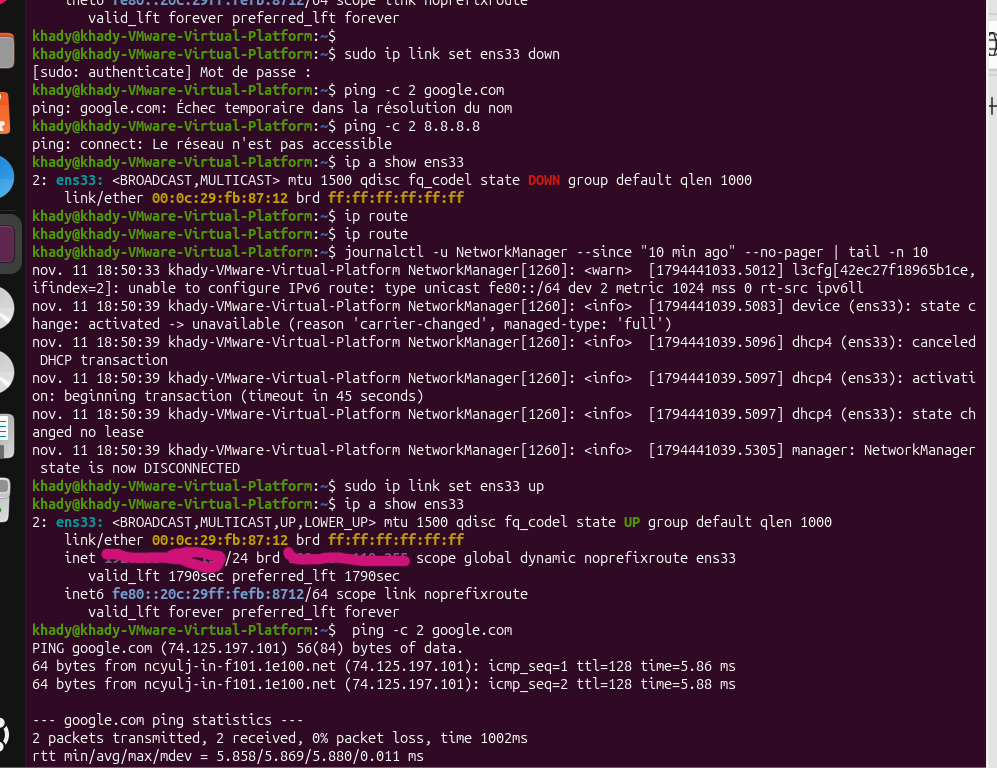
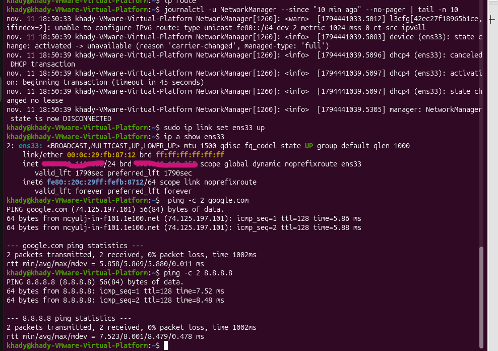
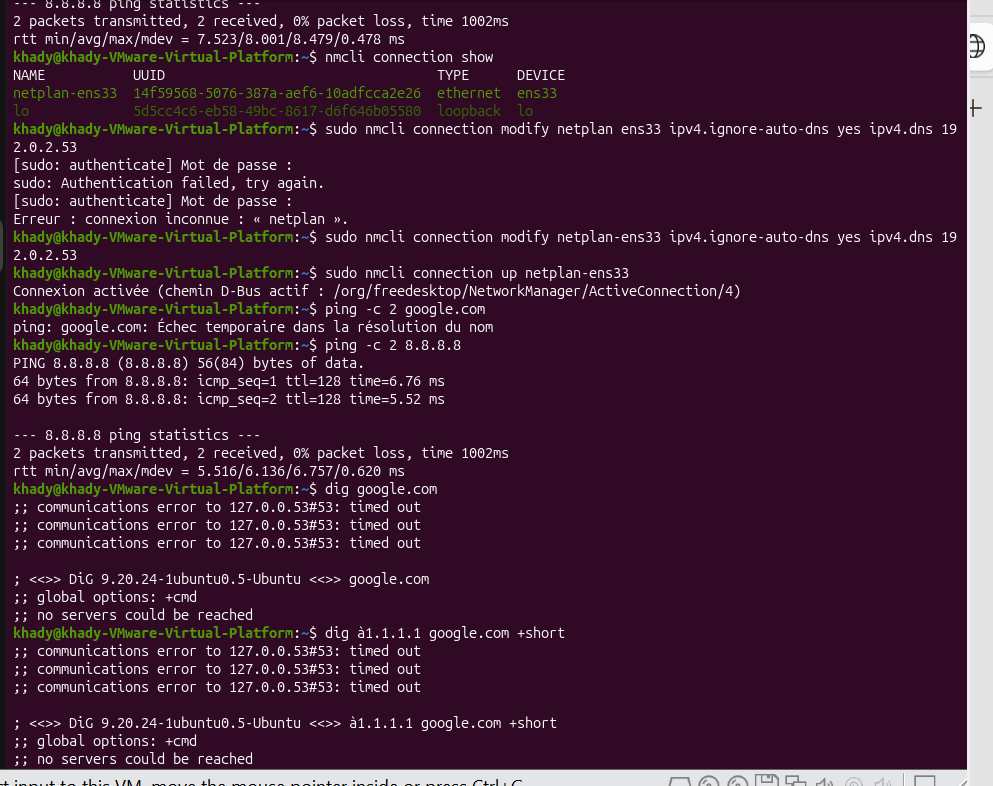
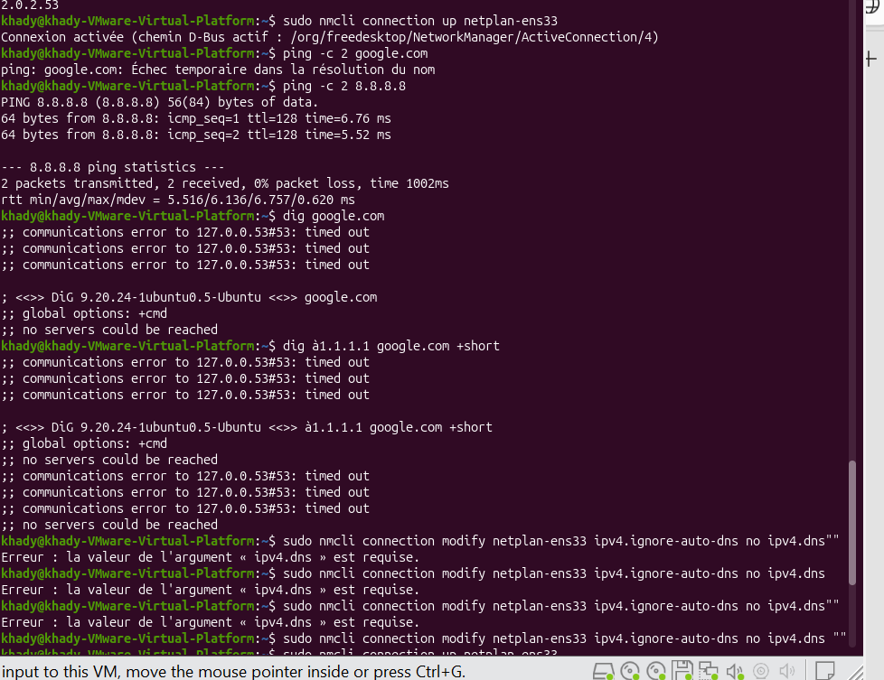
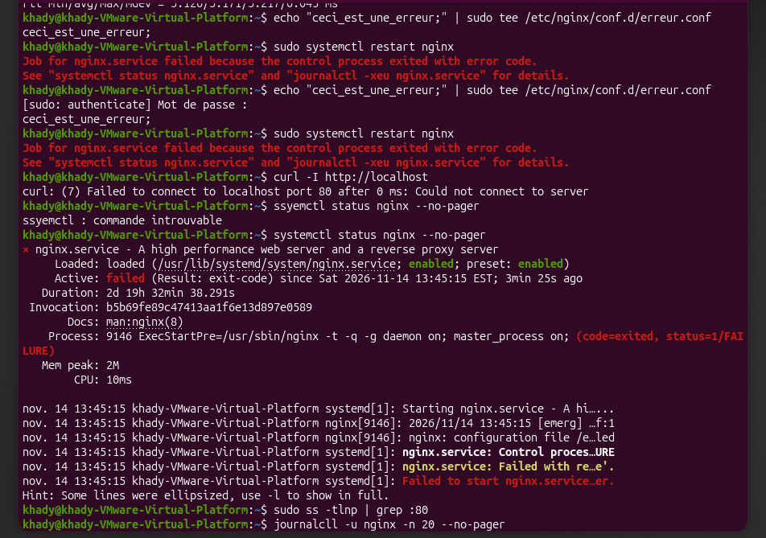

# linux-network-troubleshooting-lab
Ubuntu VM lab: network diagnostics (IP, DNS, ports, logs) and 3 simulated troubleshooting scenarios.

## 1. Project Objective

The objective of this lab is to practice network troubleshooting on an Ubuntu virtual machine.

## 2. Environment

- Operating System: Ubuntu
- Virtualization: VMware
- Network diagnostic tools: ping, ip, ss, nslookup

## 3. Network Diagnostics

This section presents the network diagnostic commands used during the lab.

## 4. Troubleshooting Scenarios

Three network troubleshooting scenarios were simulated and analyzed.

## 5. Screenshots

The following folder contains screenshots showing the different steps and results of the lab.

## 5. Screenshots

### Network Diagnostics

### System Logs and Web Server

### Troubleshooting Scenarios

