# Linux & Network Troubleshooting Lab

**Summary (EN):** Ubuntu 24.04 virtual machine lab where I practiced network diagnostics
(TCP/IP, DNS, ping, dig, ss) and system log analysis, then diagnosed and documented
three simulated incidents.

**Résumé (FR) :** Laboratoire personnel réalisé en novembre 2026 dans le cadre de ma
préparation à un stage en informatique. Objectif : comprendre comment une machine Linux
communique sur le réseau et savoir diagnostiquer des pannes simples de façon méthodique.

## Environnement

| Élément | Détail |
|---|---|
| Hyperviseur | VMware sur [Windows 11] |
| Système invité | Ubuntu 24.04 LTS Desktop |
| Ressources de la VM | 4 Go de RAM, 2 processeurs, disque de 25 Go |
| Réseau | Mode NAT (adresse 10.0.2.15/24, passerelle 10.0.2.2) |
| Outils | ip, ping, dig, nslookup, resolvectl, ss, journalctl, systemctl, nmcli, ufw, nginx, curl |

## 1. Diagnostics de base

### Adresse IP et interface
```bash
ip a
```
Interface `[ens33]`, adresse IPv4  obtenue par DHCP, adresse MAC `[08:00:27:xx:xx:xx]`.


### Passerelle par défaut
```bash
ip route
```
La route par défaut passe par  (passerelle NAT de VMware).


### Connectivité
```bash
ping -c 4 127.0.0.1    # pile réseau locale
ping -c 4 ####     # passerelle
ping -c 4 8.8.8.8      # Internet par adresse IP
ping -c 4 google.com   # Internet par nom (DNS)
```
[Résultat : 0 % de perte, latence moyenne d'environ XX ms.]


### Résolution DNS
```bash
dig google.com
resolvectl status
```
[Statut NOERROR, réponse en XX ms. Le résolveur local 127.0.0.53 relaie vers ####]


### Ports en écoute
```bash
sudo ss -tulpn
```
| Port | Protocole | Service | Exposé au réseau ? |
|---|---|---|---|
| 53 | UDP/TCP | systemd-resolved | Non (127.0.0.53) |
| 631 | TCP | cupsd (impression) | Non (127.0.0.1) |
| 80 | TCP | nginx | Oui (0.0.0.0) |


### Journaux système
```bash
journalctl -b -p warning
journalctl -b | grep -i dhcp
```
[Ce que j'ai observé : par ex. l'obtention du bail DHCP pour l'adresse ip]


## 2. Problèmes simulés

Méthode suivie : interface → adresse IP → passerelle → Internet par IP → DNS → service.

### Problème 1 : interface réseau désactivée
- **Symptômes :** `ping 8.8.8.8` renvoie « Network is unreachable ».
- **Diagnostic :** `ip a` montre l'interface en `state DOWN`, sans adresse IPv4 ; `ip route` est vide.
- **Cause :** interface désactivée (`ip link set ens33 down`).
- **Solution :** `sudo ip link set enp0s3 up` puis vérification avec `ip a` et `ping`.
- **Leçon :** toujours vérifier la couche la plus basse en premier.


### Problème 2 : DNS mal configuré
- **Symptômes :** `ping 8.8.8.8` fonctionne mais `ping google.com` échoue
  (« Temporary failure in name resolution »).
- **Diagnostic :** `dig google.com` expire ; `dig @1.1.1.1 google.com` fonctionne ;
  `resolvectl status` montre un serveur DNS incorrect (192.0.2.53).
- **Cause :** serveur DNS manuel invalide dans la configuration NetworkManager.
- **Solution :** retour au DNS fourni par DHCP avec `nmcli`, puis vérification.
- **Leçon :** interroger un autre serveur DNS permet d'isoler rapidement la cause.


### Problème 3A : le service web ne démarre plus
- **Symptômes :** `curl http://localhost` renvoie « Couldn't connect to server ».
- **Diagnostic :** `systemctl status nginx` indique `failed` ; `journalctl -u nginx`
  signale « unknown directive » dans `/etc/nginx/conf.d/erreur.conf` ; `nginx -t` échoue.
- **Solution :** suppression du fichier fautif, `nginx -t`, puis `systemctl start nginx`.
- **Leçon :** les journaux donnent souvent la cause exacte ; tester la configuration avant de redémarrer.


### Problème 3B : port 80 bloqué par le pare-feu
- **Symptômes :** le site répond dans la VM (`curl localhost`) mais pas depuis l'hôte
  (redirection de port 8080 → 80).
- **Diagnostic :** `ss` montre nginx en écoute sur 0.0.0.0:80 ; `ufw status` : refus par défaut,
  aucune règle pour le port 80 ; journal du noyau : `[UFW BLOCK] ... DPT=80`.
- **Solution :** `sudo ufw allow 80/tcp`.
- **Leçon :** « marche localement mais pas à distance » oriente vers un pare-feu.


## 3. Ce que j'ai appris
- [Ex. : lire une table de routage et identifier la passerelle.]
- [Ex. : distinguer un problème de connectivité d'un problème DNS.]
- [Ex. : utiliser journalctl pour trouver la cause d'un service en échec.]

## 4. Difficultés rencontrées
- [Ex. : écran noir au premier démarrage, résolu en augmentant la mémoire vidéo à 128 Mo.]

## 5. Prochaines étapes
- Laboratoire de dépannage Windows (décembre 2026).

---
*Laboratoire personnel réalisé sur ma propre machine, à des fins d'apprentissage.*


## 5. Screenshots

### Network Diagnostics


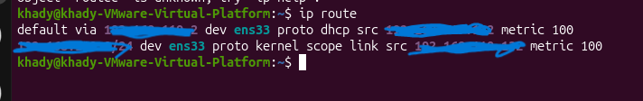

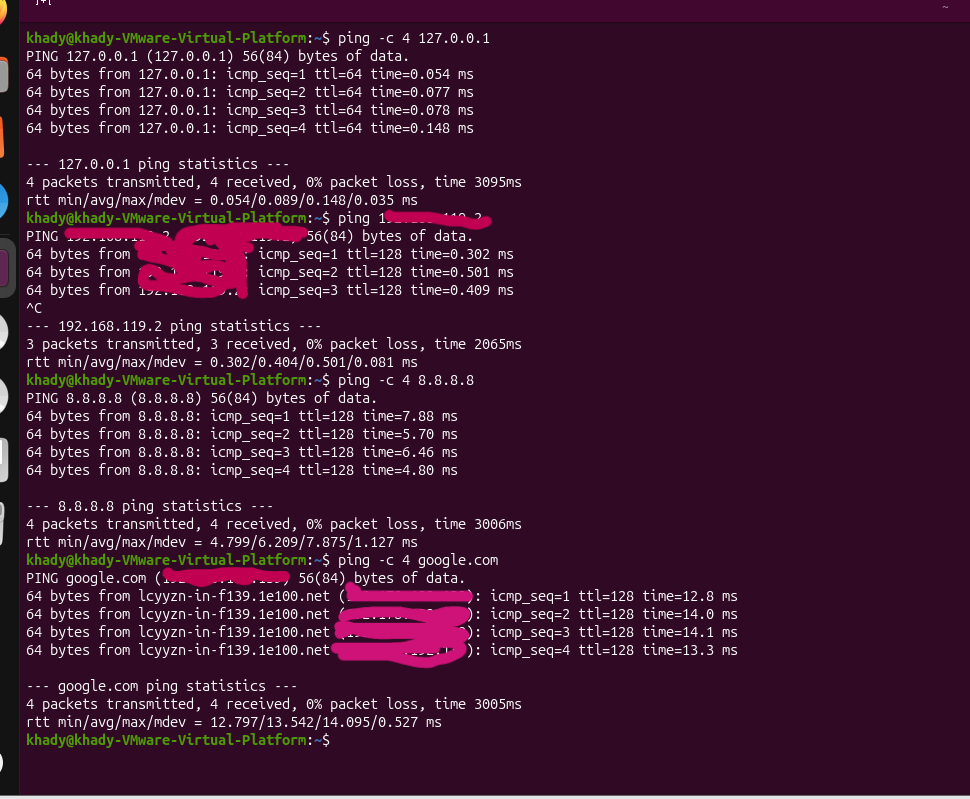


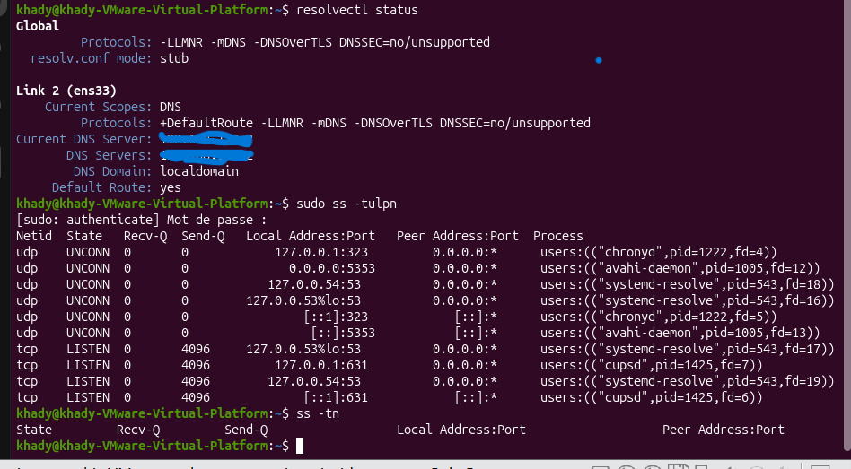

### System Logs and Web Server


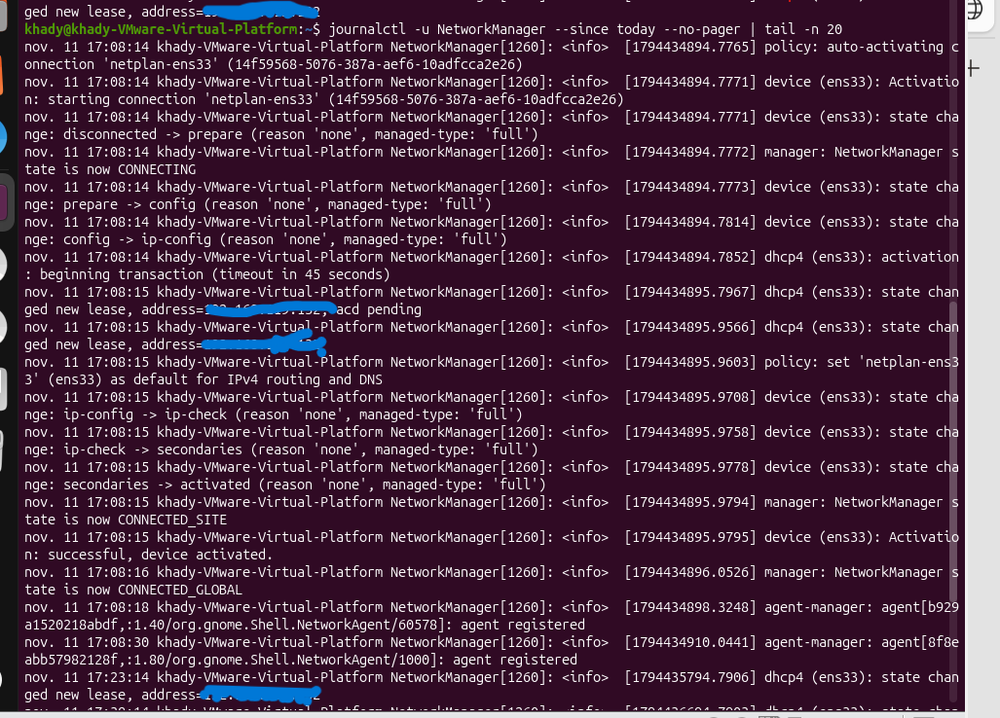


### Troubleshooting Scenarios


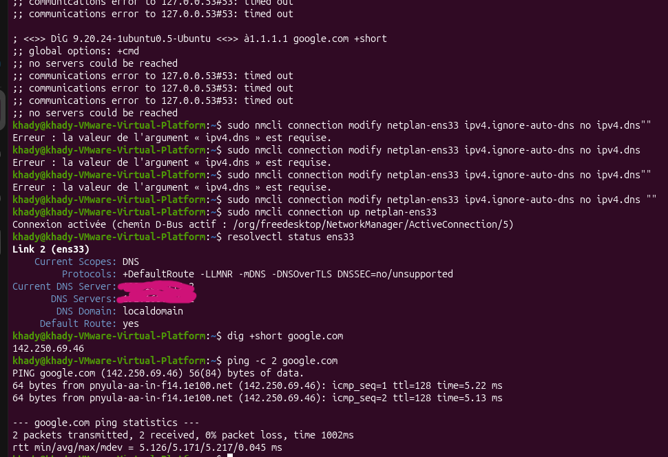


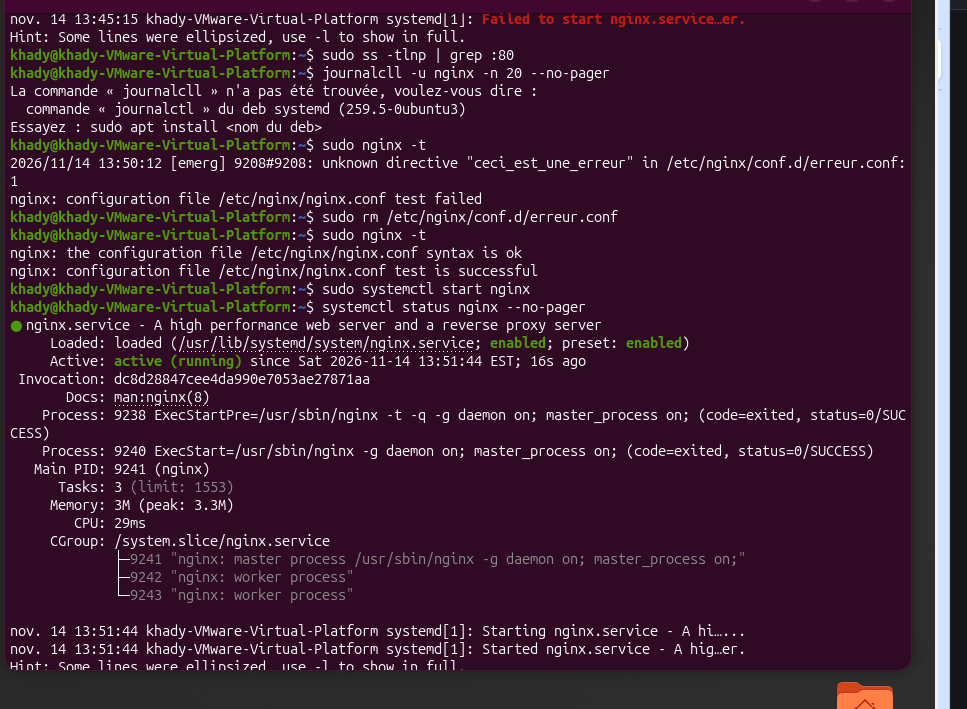

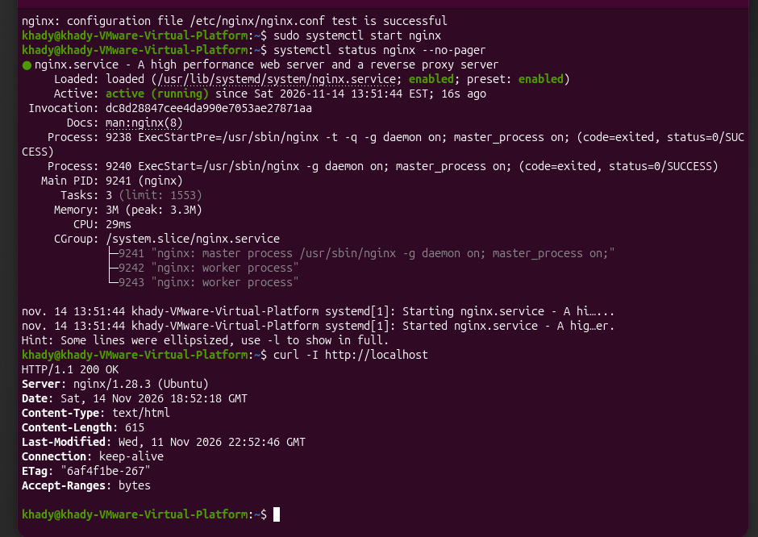

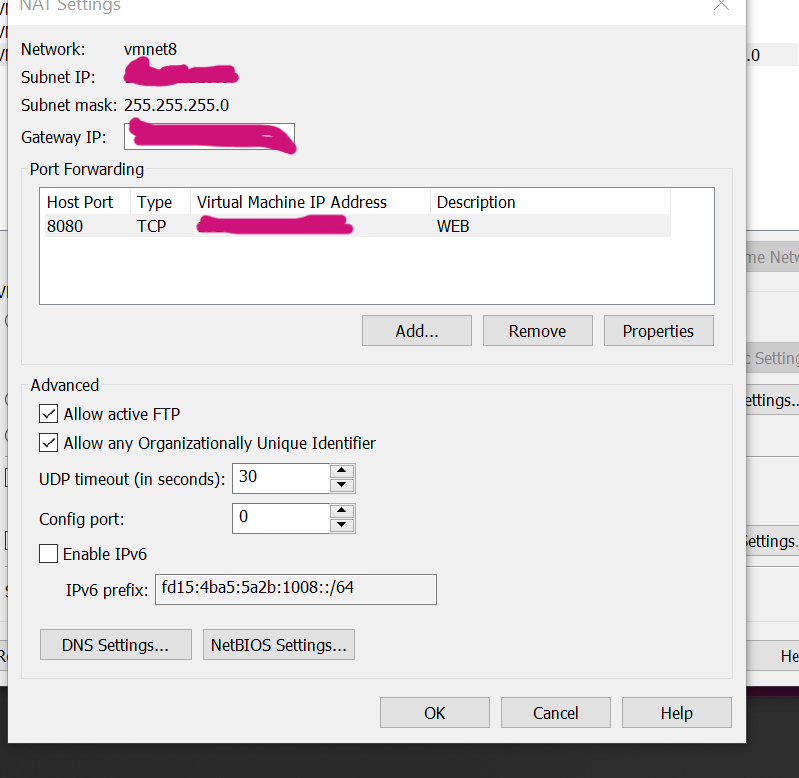

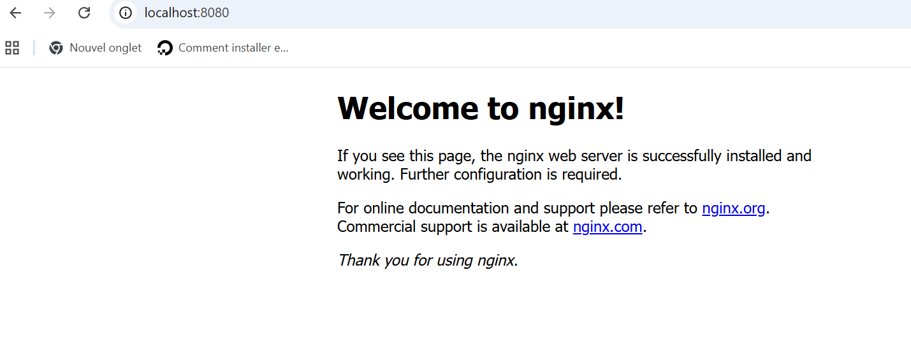

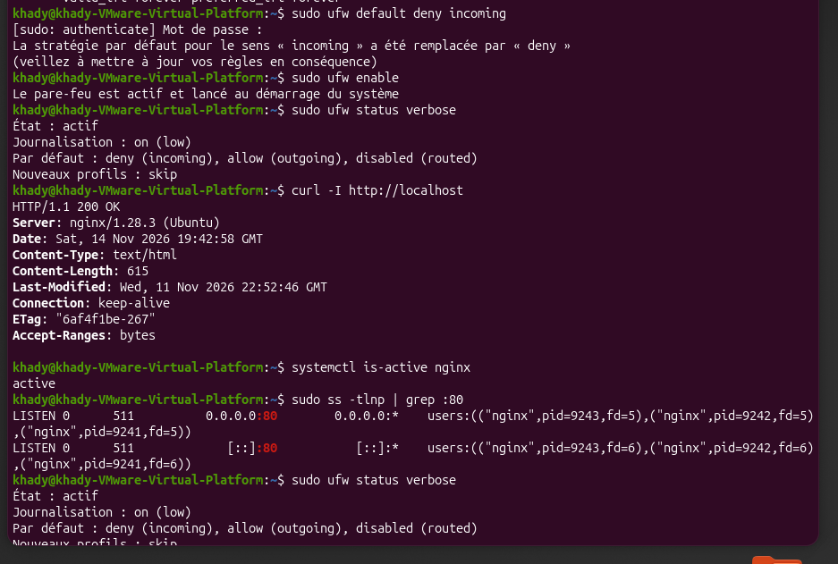

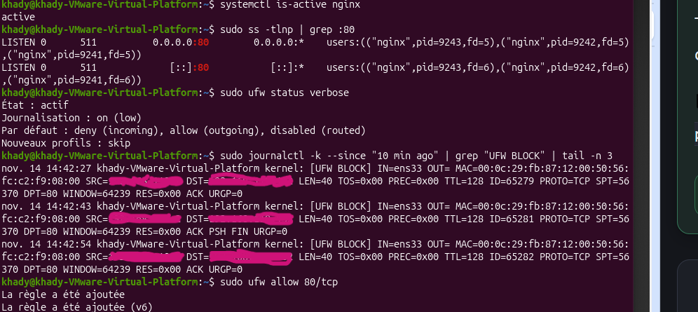

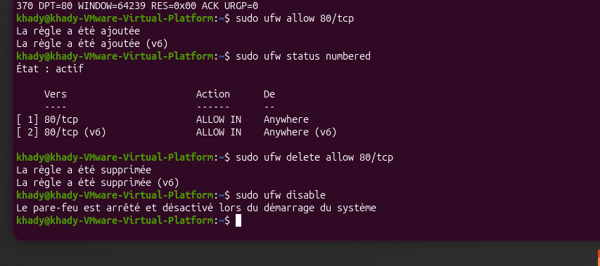


